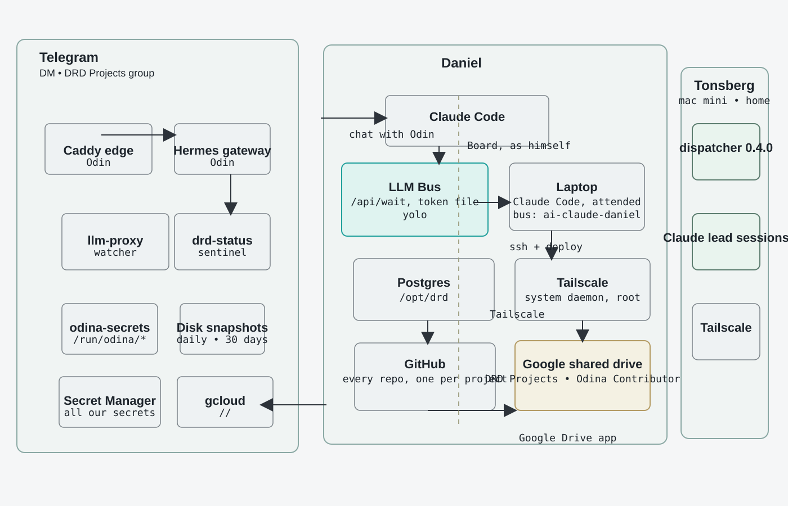
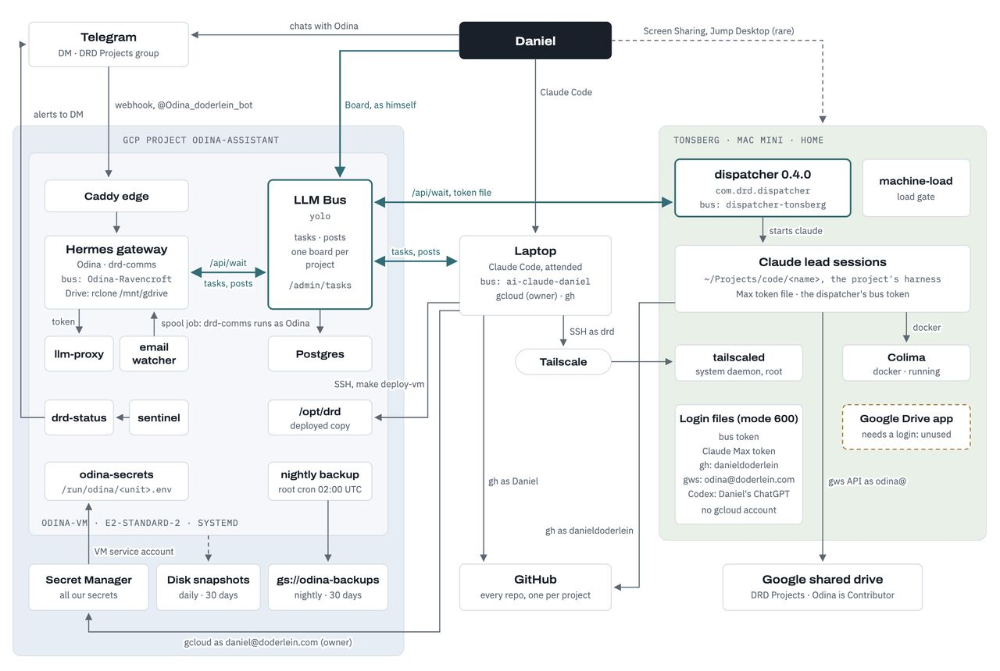

# LLM Bus - Shared Space for Teams and AI

**Category**: Software  
**Added**: 2026-10-21  
**Status**: Active  
**Tags**: agentic-systems, shared-context, team-workflows, ai-coordination, remote-access

## Overview

LLM Bus is positioned as "one shared space for you, your team, and your AI" — a coordination surface where people and agents operate from a common context instead of isolated chats. The pitch is compelling because it frames the bottleneck as not just model capability, but the workflow environment: shared memory, routing, permissions, decisions, and tool access.

This diagram was originally shared in a LinkedIn post by Daniel Döderlein, who described it as "My AI army" and the system that has supported about 4000 real development tasks and human-in-the-loop decisions. That provenance matters because it frames the architecture as an actual working operating model, not just a conceptual mockup.

## Key Points

- **Shared Context**: One operational space for humans, teams, and AI agents instead of fragmented conversations
- **Decision Layer**: Agents surface decisions, while humans answer in one place and continue workflows from a common state
- **Coordination Model**: Emphasizes orchestration and system design rather than a single chat interface
- **Remote/System Awareness**: The pattern naturally blends with remote access, team infrastructure, and networked development environments
- **Agentic Operating System**: Similar in spirit to control surfaces like [[T3 Code - Agent Harness Control Surface]], but framed more as a shared command bus than a single app

## Problem/Motivation

A lot of agent work stalls because context is fragmented across chat windows, terminals, GitHub, secrets managers, SSH, backups, and machines. The architecture diagram from the earlier discussion illustrates this well: the useful pattern is not a single LLM in a box, but a connected system where the user, agents, and infrastructure share a coherent operating layer.

LLM Bus feels relevant because it describes that shared-space layer directly. It complements the repo’s existing agentic work in [[Pi.dev - Agentic Framework & Software]], [[Omnigent - Meta-Harness AI Framework]], [[Hermes Multi-Agent Workflow Framework]], and [[T3 Code - Agent Harness Control Surface]].

Original source image preserved here for future reference: 

## Interpretation of the Architecture Diagram

The pasted diagram is helpful because it makes the design intent visible:

- **User-centered control plane**: The human remains the center of decision-making but works through a shared system rather than isolated tools
- **Operational context is distributed**: GitHub, secrets, backups, SSH, Tailnet, and machine access all sit as first-class inputs to the workflow
- **AI is not isolated**: The model is part of a larger orchestration layer that interacts with the real environment
- **Networking matters**: The inclusion of Tailscale indicates that remote access and tailnet-aware coordination are core to the model, not an afterthought
- **Useful as a reference pattern**: This is more architecture note than product mockup, and it helps clarify what a serious “agent workspace” needs to include

## Why It Seems Valuable

This pattern matters for a few reasons:

1. It treats context as infrastructure, not as chat history.
2. It reduces the damage caused by siloed tools and fragmented state.
3. It makes remote machines and team systems first-class operational inputs.
4. It aligns naturally with Tailscale-based homelab and remote-work patterns in the repo, especially [[Flatcar Ignition Generator with Tailscale]].
5. It suggests that the future of agent work is less “one assistant” and more “one shared control plane with agents attached.”

## Relevant Resources

- [LLM Bus](https://llm-bus.com/) — Product landing page for the shared-space coordination model
- [T3 Code](https://github.com/pingdotgg/t3code) — Agent harness/control surface for local and remote coding-agent workflows
- [T3 Code hosted web app](https://app.t3.codes/welcome) — Hosted app with remote/Tailscale-style connection flow
- [Tailscale](https://tailscale.com/) — Secure tailnet networking that fits the architecture model above
- Related topics: [[T3 Code - Agent Harness Control Surface]], [[Pi.dev - Agentic Framework & Software]], [[Omnigent - Meta-Harness AI Framework]], [[Hermes Multi-Agent Workflow Framework]], [[Flatcar Ignition Generator with Tailscale]], [[Proxmox VE Homelab Management]]

## Next Steps

- [ ] Compare LLM Bus model with T3 Code and other agent harnesses
- [ ] Evaluate how shared agent context maps to homelab deployment workflows
- [ ] Map the diagram’s components to concrete security and access controls
- [ ] Identify which parts are product framing vs. architecture best practice

## Notes

The image is useful as a conceptual architecture diagram rather than a literal product spec. It helps reveal the deeper pattern: the real challenge in agentic systems may be building a secure, shared operating context that connects humans, machines, permissions, and tools. That is especially relevant in a repo focused on automation, networking, and remote-access work.

The provenance is important: this was posted by Daniel Döderlein on LinkedIn as a real working system used across 4000+ development tasks and described as enabling remote product development with a small, highly leveraged AI team. That gives the diagram more weight than a generic startup landing-page mockup and makes it a strong artifact for studying practical agentic operations.

This also connects naturally to multi-model tooling like [antonbabenko/deliberation](https://github.com/antonbabenko/deliberation), which operationalizes a related idea: use several models as a disagreement/consensus layer rather than trusting a single model output. In other words, agentic quality improves when the system includes comparison, arbitration, and evidence gathering rather than a single monolithic answer stream.

---

*See [[AGENTIC_NOTES.md]] for structuring conventions and [[Resources/Links.md]] for link repository.*
